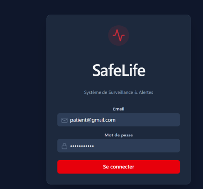
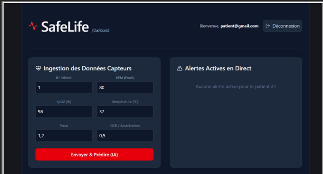
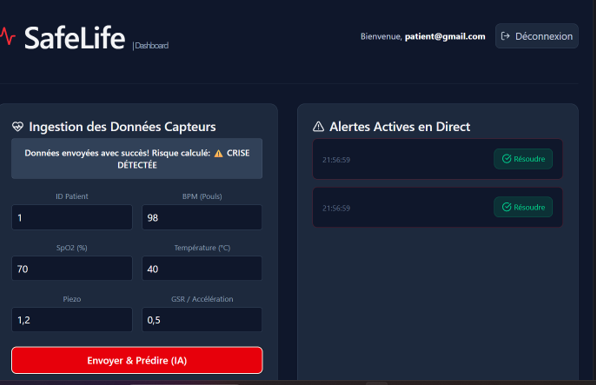

# SafeLife

A smart medical bracelet system that aims to detect cardiac, neurological and epileptic crises, with a web dashboard for patients and doctors.

> Student project, IPSAS. Status: in development.

## Features
- Sensor data collection (ECG, heart rate/SpO₂, motion, temperature, GSR) from an ESP32-based bracelet
- Predictive AI model analyzing heart rate variability (HRV) to flag risky states
- Real-time alerts per patient
- Secure authentication (JWT) with patient and doctor roles
- React dashboard with live charts

## Tech stack
| Layer | Technologies |
|---|---|
| Hardware | ESP32, AD8232, MAX30102, MPU6050, MLX90614, GSR |
| Backend | Python, FastAPI, SQLAlchemy, SQLite (dev), JWT |
| AI | scikit-learn, joblib, HRV features |
| Frontend | React, Vite, Recharts |
| DevOps | Docker, Docker Compose |

## Architecture
Bracelet (ESP32) → FastAPI backend (+ AI model) → React dashboard

## Getting started

1. Clone the repo

```bash
git clone https://github.com/chaouachi1806/safelife.git
cd safelife
```

2. Create a `.env` file (see `.env.example`):

```
SECRET_KEY=your_secret_key
DEMO_PASSWORD=your_demo_password
```

3. Run with Docker

```bash
docker compose up --build
```

Or manually:

```bash
# Backend
cd backend
pip install -r requirements.txt
uvicorn app.main:app --reload

# Frontend (in another terminal)
cd frontend
npm install
npm run dev
```

The dashboard runs on http://localhost:5173.

## Screenshots

### Login


### Dashboard


### Alerts


## What I learned
Connecting hardware, API, AI and UI into one system, and handling secrets properly in a medical-style application.

## Author
Amel Chaouachi, IPSAS, Vice-president of the IEEE student branch
